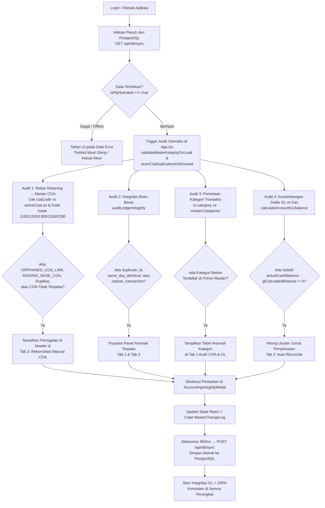
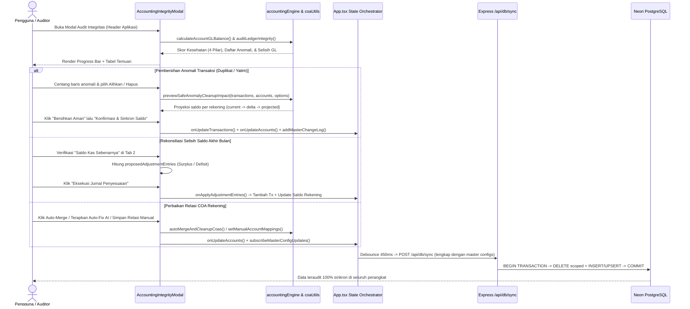

# Protokol Validasi Integritas Ledger & Panduan `AccountingIntegrityModal`

Dokumen ini menjelaskan siklus hidup validasi integritas buku besar (*General Ledger / GL*) dan *Chart of Accounts* (COA) pada **Nusantara Wealth**, matriks perbaikan untuk setiap jenis anomali COA maupun transaksi, serta panduan langkah demi langkah penggunaan **`AccountingIntegrityModal`**.

> **Kebijakan Sumber Tunggal (*Single Source of Truth*)**: Seluruh data transaksi, saldo rekening, `Master COA` (`coaList`), kode `coaCode` per rekening, hierarki `masterCategories`, konfigurasi KPR, target investasi, dan log perubahan master (`masterChangeLogs`) **disimpan dan dimuat langsung dari PostgreSQL** (`/api/db/sync`)—bukan dari `localStorage` browser—sehingga hasil audit integritas di komputer mana pun selalu identik.

---

## 1. Arsitektur & Diagram Alur Siklus Validasi Integritas

Validasi integritas berjalan secara berlapis: mulai dari hidrasi PostgreSQL, pemindaian otomatis saat data berubah (`validateMasterIntegrityOnLoad` & `scanCoaDuplicatesAndUnused`), pemeriksaan GL (`auditLedgerIntegrity` & `calculateAccountGLBalance`), hingga simulasi dampak saldo sebelum perbaikan diterapkan (`previewSafeAnomalyCleanupImpact`).

### 1.1 Diagram Alur Siklus Validasi Integritas (*Flowchart*)

### 1.2 Diagram Urutan Eksekusi Perbaikan Anomali (*Sequence Diagram*)

---

## 2. Empat Pilar Skor Kesehatan Integrasi Data Akuntansi

Di bagian atas `AccountingIntegrityModal`, sistem menghitung **Skor Integritas GL** (`overallHealthScore`) sebagai rata-rata dari 4 metrik integritas real-time:

1. **Koneksi COA Rekening (`accountCoaPct`)**: Persentase rekening aktif yang memiliki kode COA valid dan tidak berstatus `isOrphaned`.
2. **Pemetaan Kategori COA (`categoryMappingPct`)**: Persentase kategori unik pada riwayat transaksi yang sudah terdaftar di pohon `masterCategories`.
3. **Keseimbangan Saldo GL vs Kas (`balanceReconciledPct`)**: Persentase rekening dengan selisih `actualCashBalance - glCalculatedBalance === 0`.
4. **Validitas Buku Besar (`ledgerValidPct`)**: Rasio transaksi bersih terhadap total temuan `auditLedgerIntegrity` (`duplicate_id`, `same_day_identical`, dan `orphan_transaction`).

Predikat kesehatan:
- **`>= 90%`**: *Sangat Sehat* (Hijau)
- **`70% – 89%`**: *Perlu Perhatian* (Kuning/Amber)
- **`< 70%`**: *Anomali Tingkat Tinggi* (Merah/Rose)

---

## 3. Matriks Perbaikan Masalah (*Problem Repair Matrix*)

Gunakan matriks di bawah ini untuk memetakan temuan pada modal audit ke akar penyebab dan tindakan perbaikan yang aman.

### 3.1 Matriks Anomali *Chart of Accounts* (COA) & Kategori

| Kode / Jenis Anomali | Lokasi Deteksi UI | Akar Penyebab | Dampak Jika Dibiarkan | Tindakan Perbaikan di Aplikasi | Fungsi Inti Terkait |
| :--- | :--- | :--- | :--- | :--- | :--- |
| **`ORPHANED_COA_LINK`** *(COA Terhapus!)* | Banner Peringatan Header & Tab **3. Rekonsiliasi Manual COA** | Akun rekening menyimpan `acc.coaCode` yang sudah dihapus atau tidak ada di `coaList` aktif. | Akun jatuh ke pemetaan *fallback* sementara dan klasifikasi Neraca bisa tidak presisi. | Gunakan **Terapkan Auto-Fix** pada panel *Rekomendasi Auto-Fix AI* atau pilih kode COA baru di dropdown **Pilih Pemetaan Master COA** lalu klik **Simpan & Perbarui Relasi Sistem**. | `getAccountCoaMapping` `validateMasterIntegrityOnLoad` |
| **`MISSING_BASE_COA`** *(COA Induk Hilang)* | Audit Startup (`validateMasterIntegrityOnLoad`) | Salah satu kode COA standar wajib (`1100` Kas, `1200` Bank, `1300` E-Wallet, `2100` Kartu Kredit, `2200` PayLater) terhapus. | Rekening baru atau tanpa `coaCode` eksplisit kehilangan referensi induk standar. | Buka menu **Master Kategori & COA** atau jalankan **Gabung Duplikat & Bersihkan COA Otomatis** / `synchronizeAccountsAndCOA` untuk memulihkan simpul dasar. | `synchronizeAccountsAndCOA` `mergeMissingDefaultCoas` |
| **Kode / Nama COA Duplikat** | Tab **3. Rekonsiliasi Manual COA** (Kartu *Hasil Pemindaian Otomatis COA*) | Impor data lama atau penambahan manual menghasilkan dua entri COA dengan `code` sama atau nama identik. | Kebingungan saat memilih COA rekening dan duplikasi pelaporan kategori akun. | Klik tombol **Gabung Duplikat & Bersihkan COA Otomatis**. Sistem menggabungkan duplikat ke node induk lalu otomatis memperbarui `acc.coaCode` yang terdampak. | `scanCoaDuplicatesAndUnused` `autoMergeAndCleanupCoas` |
| **COA Kustom Tidak Terpakai** | Tab **3. Rekonsiliasi Manual COA** (*COA Tidak Terpakai*) | Kode COA non-standar pernah dibuat tetapi tidak dipakai oleh rekening maupun transaksi mana pun. | Daftar COA menjadi penuh oleh simpul yatim (*unused nodes*). | Klik **Gabung Duplikat & Bersihkan COA Otomatis** untuk menghapus COA kustom tidak terpakai sambil menjaga seluruh COA standar bawaan tetap aman. | `autoMergeAndCleanupCoas` |
| **Kategori Transaksi Belum Terdaftar** | Tab **1. Audit COA & GL** (*Anomali Kategori Belum Terdaftar*) | Transaksi hasil impor/input manual memakai nama `tx.category` yang belum ada di hierarki `masterCategories`. | Grafik penganggaran dan pivot kategori mengelompokkan transaksi secara terpisah dari pohon utama. | Klik tombol **Otomatis Daftarkan & Harmoniskan COA** pada footer Tab 1. Sistem menambahkan kategori tersebut ke pohon kategori pengeluaran secara otomatis. | `onHarmonize` `mergeMissingDefaultCategories` |

### 3.2 Matriks Anomali Transaksi & Buku Besar (*Ledger*)

| Kode / Jenis Anomali | Lokasi Deteksi UI | Akar Penyebab | Dampak Saldo GL vs Kas | Tindakan Perbaikan Aman | Fungsi Inti Terkait |
| :--- | :--- | :--- | :--- | :--- | :--- |
| **`duplicate_id`** *(ID Duplikat)* | Tab **1** & Tab **3** (Panel *Validasi Referensi Akun & Duplikasi Buku Besar*, filter **ID Duplikat**) | Dua atau lebih baris transaksi memiliki `tx.id` yang sama akibat impor ganda atau penggabungan konflik lawas. | `calculateAccountGLBalance` sudah mendeteksi & menormalkan agar baris ID ganda tidak dihitung dua kali, tetapi baris kotor tetap tampil di jurnal. | Centang baris duplikat (baris asli tetap aman dipertahankan), tinjau **Pratinjau Dampak Saldo per Rekening**, klik **Bersihkan Aman**, lalu **Konfirmasi & Sinkron Saldo**. | `auditLedgerIntegrity` `previewSafeAnomalyCleanupImpact` |
| **`same_day_identical`** *(Identik Harian)* | Tab **1** & Tab **3** (Filter **Identik Harian**) | Entri transaksi berbeda ID tercatat pada tanggal lokal, `accountId`, tipe, kategori, nominal, dan deskripsi yang persis sama. | Saldo GL terhitung ganda apabila kedua entri benar-benar hasil input ganda yang tidak disengaja. | Verifikasi apakah transaksi memang terjadi 2x di hari sama. Jika duplikat tidak sengaja, centang baris salinan, periksa koreksi saldo pada pratinjau, lalu klik **Konfirmasi & Sinkron Saldo**. | `auditLedgerIntegrity` `normalizeLedgerDateYYYYMMDD` |
| **`orphan_transaction`** *(Transaksi Yatim)* | Tab **1** & Tab **3** (Filter **Transaksi Yatim**) | `tx.accountId` kosong (`missing_account_id`) atau merujuk pada ID rekening yang sudah dihapus (`missing_account_record`). | Transaksi tidak masuk ke `calculateAccountGLBalance` rekening aktif mana pun, sehingga total arus kas/laporan tidak sinkron dengan saldo kas. | Pada kolom **Rekening / Tindakan**, pilih: • **Alihkan**: pilih rekening tujuan valid (disarankan agar histori kas terjaga). • **Hapus Baris**: hapus permanen jika memang entri sampah. Lalu klik **Bersihkan Aman → Konfirmasi & Sinkron Saldo**. | `auditLedgerIntegrity` `previewSafeAnomalyCleanupImpact` |
| **Selisih Saldo GL vs Kas Fisik** *(Unreconciled)* | Tab **1** (Tabel *Audit Saldo Buku Besar*) & Tab **2. Auto-Reconcile** | Pencatatan transaksi manual terlewat, biaya admin bank/bunga belum dicatat, atau perubahan saldo awal rekening tidak selaras. | Status akun tampil **Unreconciled**; saldo kas tercatat berbeda dari `startingBalance - initialDebt + calculatedDelta`. | Buka **Tab 2. Auto-Reconcile**, masukkan nominal riil di kolom **Saldo Kas Sebenarnya (Rp)**, periksa **Usulan Jurnal Penyesuaian Otomatis**, lalu klik **Eksekusi Jurnal Penyesuaian**. | `calculateAccountGLBalance` `getTransactionAccountDelta` `applyAccountBalanceChange` |
| **Ketidaksinkronan Kredit / PayLater** | Tab **2. Auto-Reconcile** | Tagihan terpakai kartu kredit/paylater (`usedLimit`) bergeser dari riwayat transaksi belanja & pembayaran tagihan. | Proyeksi `Sisa Limit` & tagihan (`getAccountCreditBill`) tidak cocok dengan tagihan kartu sebenarnya. | Masukkan nilai sisa limit aktual di Tab 2; sistem menghasilkan jurnal penyesuaian yang memperbarui `currentBalance` & `usedLimit` sekaligus via `applyTransactionsToAccounts`. | `isCreditAccount` `getAccountCreditBill` `applyTransactionsToAccounts` |

---

## 4. Panduan Langkah demi Langkah Menggunakan `AccountingIntegrityModal`

### Langkah 0: Membuka Modal Audit Integritas
1. Pastikan aplikasi sudah selesai memuat data dari PostgreSQL (tidak ada pesan error koneksi cloud).
2. Klik tombol ikon **Perisai / Audit Integritas Akuntansi** pada header atas aplikasi (ikon berubah warna peringatan jika skor integritas `< 100%` atau ditemukan anomali).
3. Di bagian paling atas modal, periksa panel **Tingkat Kesehatan Integrasi Data Akuntansi** untuk melihat skor persentase keseluruhan dan 3 *progress bar* pilar utama.

---

### Langkah 1: Audit Kategori, Anomali Buku Besar, & Saldo GL (**Tab `1. Audit COA & GL`**)
1. Baca **Banner Status** di bagian atas tab:
   - Hijau (*Seluruh Struktur Jurnal & Referensi Valid!*): tidak ada kategori liar, duplikat, atau transaksi yatim.
   - Kuning (*Anomali Integritas Terdeteksi!*): menampilkan ringkasan jumlah kategori belum terdaftar, ID duplikat, identik harian, dan transaksi yatim.
2. **Jika muncul tabel `Anomali Kategori Belum Terdaftar`**:
   - Periksa daftar nama kategori beserta jumlah transaksi (`tx`) dan akumulasi nominalnya.
   - Klik tombol **Otomatis Daftarkan & Harmoniskan COA** di footer kanan bawah modal untuk mendaftarkan kategori tersebut ke Master Kategori secara otomatis.
3. **Jika muncul temuan pada panel `Validasi Referensi Akun & Duplikasi Buku Besar`**:
   - Klik **Pindai Ulang** kapan saja untuk menyegarkan hasil scan terbaru.
   - Gunakan filter segmen: **Semua**, **ID Duplikat**, **Identik Harian**, atau **Transaksi Yatim**.
   - Untuk **Transaksi Yatim**, pilih mode **Alihkan** (lalu pilih rekening tujuan) atau **Hapus Baris** pada kolom *Rekening / Tindakan*.
   - Centang baris yang ingin diperbaiki (atau klik **Pilih Semua**).
   - Periksa tabel **Pratinjau Dampak Saldo per Rekening** yang muncul di bawah tabel anomali (*Saldo Saat Ini → Koreksi Bersih → Proyeksi Saldo Akhir*).
   - Klik **Bersihkan Aman (N Baris)**, baca ringkasan konfirmasi merah, lalu klik **Konfirmasi & Sinkron Saldo**.
4. **Periksa tabel `Audit Saldo Buku Besar (GL) & Log Transaksi`**:
   - Pastikan seluruh rekening berstatus hijau **Reconciled**. Jika ada rekening berstatus **Unreconciled**, lanjutkan ke **Tab 2**.

---

### Langkah 2: Menyeimbangkan Saldo GL & Kas Fisik (**Tab `2. Auto-Reconcile`**)
1. Buka tab **2. Auto-Reconcile** (lencana angka merah menandakan jumlah rekening yang memiliki selisih).
2. Pada tabel **1. Verifikasi Saldo Kas Fisik Sebenarnya (End-of-Month Statement)**:
   - Cocokkan kolom **Saldo GL Terhitung** dengan mutasi rekening bank/dompet fisik Anda.
   - Ubah angka pada kolom input **Saldo Kas Sebenarnya (Rp)** jika berbeda dari angka yang tercatat.
   - Kolom **Selisih (Variance)** otomatis menampilkan nominal surplus (`+`) atau defisit (`-`).
3. Gulir ke bagian **2. Usulan Jurnal Penyesuaian Otomatis**:
   - **Defisit kas (`difference < 0`)** → mengusulkan transaksi `expense` (*Beban Operasional Lainnya*, kredit ke rekening terkait).
   - **Surplus kas (`difference > 0`)** → mengusulkan transaksi `income` (*Pendapatan Lain-lain*, debet ke rekening terkait).
   - Periksa proyeksi saldo (`Proyeksi Saldo` atau `Sisa Limit` untuk kartu kredit/paylater).
4. Klik tombol **Eksekusi Jurnal Penyesuaian (N)** (atau **Eksekusi Auto-Reconciliation** di footer) untuk membukukan entri penyesuaian resmi ke jurnal dan menyamakan saldo GL menjadi **100% Match**.

---

### Langkah 3: Merapikan Duplikat COA & Memetakan Rekening (**Tab `3. Rekonsiliasi Manual COA`**)
1. Buka tab **3. Rekonsiliasi Manual COA**.
2. Pada kartu **Hasil Pemindaian Otomatis COA**:
   - Lihat jumlah **COA Duplikat**, **COA Tidak Terpakai**, dan **Anomali Buku Besar**.
   - Klik **Gabung Duplikat & Bersihkan COA Otomatis** apabila terdeteksi duplikat atau node COA non-standar tidak terpakai.
   - Jika terdapat anomali buku besar, Anda dapat langsung menekan **Pilih & Pratinjau Duplikat** dan membersihkannya dari panel detail di bawah kartu.
3. **Jika muncul kartu `Rekomendasi Auto-Fix AI`**:
   - Sistem mencocokkan nama dan tipe rekening terhadap Master COA menggunakan skor kemiripan (*confidence %*).
   - Klik **Terapkan Auto-Fix** per akun atau **Terapkan Semua Saran Auto-Fix** untuk menghubungkan akun ke COA secara instan.
4. **Pemetaan Manual Eksplisit**:
   - Cari rekening melalui kolom pencarian *Cari nama atau tipe rekening...*.
   - Ubah dropdown **Pilih Pemetaan Master COA** (`[kode] Nama COA (Kategori)`) sesuai kebutuhan.
   - Klik **Simpan & Perbarui Relasi Sistem** agar perubahan `coaCode` tersimpan ke state dan otomatis tersinkron ke PostgreSQL.

---

### Langkah 4: Audit Jejak Perubahan & Ekspor CSV (**Tab `4. Log Riwayat Master`**)
1. Buka tab **4. Log Riwayat Master** untuk meninjau jejak audit setiap aksi `CREATE`, `UPDATE`, `DELETE`, `RECONCILE`, dan `SYNC` pada `COA`, `Account`, `Category`, maupun `KPR`.
2. Gunakan kotak pencarian teks dan filter dropdown aksi (**Semua Aksi**, **CREATE**, **UPDATE**, **DELETE**, **RECONCILE**, **SYNC**).
3. Klik **Ekspor Log (CSV)** untuk mengunduh berkas `Log_Perubahan_MasterData_YYYY-MM-DD.csv` sebagai arsip audit eksternal.
4. *(Opsional)* Klik **Bersihkan Log → Ya, Bersihkan** hanya jika arsip CSV sudah diamankan; log yang dibersihkan juga akan ikut tersinkron ke tabel `user_master_configs` di PostgreSQL.

---

## 5. Contoh Skenario Perbaikan Anomali Nyata

Berikut tiga studi kasus umum beserta angka simulasi untuk memandu operator membaca pratinjau sebelum mengeksekusi perbaikan.

### Skenario A: Akun Bank Merujuk COA Terhapus (`ORPHANED_COA_LINK`) & Duplikat COA
- **Kondisi Awal**:
  - Rekening `"BCA Utama"` menyimpan `coaCode: "1210"`, tetapi node `1210` sudah dihapus sehingga modal memunculkan lencana merah **COA Terhapus!** dan `Skor Integritas GL` turun menjadi `88%`.
  - Di Master COA juga terdapat dua entri untuk kode `1200` akibat impor lama.
- **Langkah Perbaikan**:
  1. Buka **Tab 3. Rekonsiliasi Manual COA**.
  2. Pada kartu *Hasil Pemindaian Otomatis COA*, klik **Gabung Duplikat & Bersihkan COA Otomatis** untuk menyatukan duplikat `1200`.
  3. Pada panel *Rekomendasi Auto-Fix AI*, `"BCA Utama"` memperoleh saran `[1200] Bank / Tabungan` (*92% Cocok*). Klik **Terapkan Auto-Fix**.
- **Hasil Akhir**:
  - `coaCode` rekening `"BCA Utama"` diperbarui ke `1200`, lencana berubah menjadi **Explicit COA 1200**, log `RECONCILE` tercatat, dan perubahan tersinkron otomatis ke PostgreSQL dalam `450ms`.

### Skenario B: Transaksi Duplikat Identik Harian & Transaksi Yatim Setelah Hapus Dompet
- **Kondisi Awal**:
  - Pengguna mencatat pengeluaran makan siang `"Nasi Padang"` sebesar `Rp 45.000` di rekening `"Gopay"` dua kali pada tanggal yang sama (`same_day_identical`), sehingga saldo `"Gopay"` terpotong `Rp 90.000` (saldo tercatat `Rp 410.000`, seharusnya `Rp 455.000`).
  - Selain itu, terdapat 1 transaksi pemasukan `Rp 250.000` berstatus `orphan_transaction` karena `accountId` merujuk ke dompet lama yang sudah dihapus.
- **Langkah Perbaikan & Membaca Pratinjau**:
  1. Buka **Tab 1. Audit COA & GL** → panel **Validasi Referensi Akun & Duplikasi Buku Besar**.
  2. Centang baris salinan `"Nasi Padang"` (`-Rp 45.000`).
  3. Pada baris transaksi yatim (`+Rp 250.000`), pilih mode **Alihkan** dan arahkan ke rekening tujuan `"BCA Utama"` (saldo saat ini `Rp 10.000.000`), lalu centang baris tersebut.
  4. Periksa tabel **Pratinjau Dampak Saldo per Rekening**:
     - `"Gopay"`: `Rp 410.000` → Koreksi Bersih `+Rp 45.000` → Proyeksi Saldo Akhir **`Rp 455.000`**.
     - `"BCA Utama"`: `Rp 10.000.000` → Koreksi Bersih `+Rp 250.000` → Proyeksi Saldo Akhir **`Rp 10.250.000`**.
  5. Klik **Bersihkan Aman (2 Baris)** → **Konfirmasi & Sinkron Saldo**.
- **Hasil Akhir**:
  - Kedua saldo rekening langsung tersinkronisasi tanpa membuang histori transaksi valid, dan buku besar kembali bersih (`0` anomali).

### Skenario C: Selisih Saldo GL vs Rekening Koran Akhir Bulan (Biaya Admin & Bunga Bank)
- **Kondisi Awal**:
  - Menurut perhitungan buku besar di sistem (`Saldo GL Terhitung`), rekening `"Mandiri Tabungan"` bernilai `Rp 8.525.000`.
  - Saat mengecek mutasi m-banking akhir bulan, saldo fisik riil adalah `Rp 8.510.000` (terpotong biaya admin bank `Rp 15.000` yang belum sempat dicatat).
- **Langkah Perbaikan**:
  1. Buka **Tab 2. Auto-Reconcile**.
  2. Pada baris `"Mandiri Tabungan"`, ubah kolom **Saldo Kas Sebenarnya (Rp)** menjadi `8510000`.
  3. Kolom **Selisih (Variance)** otomatis menampilkan `-Rp 15.000` (`Selisih Rp 15.000`).
  4. Pada bagian **2. Usulan Jurnal Penyesuaian Otomatis**, sistem menyiapkan entri `expense` (*Penyesuaian Defisit (-)*) kategori `Beban Operasional Lainnya` sebesar `Rp 15.000` (`Proyeksi Saldo: Rp 8.525.000 → Rp 8.510.000`).
  5. Klik **Eksekusi Jurnal Penyesuaian (1)**.
- **Hasil Akhir**:
  - Jurnal penyesuaian resmi tercatat pada tanggal lokal hari ini, saldo `"Mandiri Tabungan"` turun ke `Rp 8.510.000`, dan status di Tab 1 berubah menjadi **Reconciled** (`Match 100%`).

---

## 6. Checklist Audit Bulanan Praktis

Jalankan daftar periksa berikut setiap akhir bulan (atau sebelum membuat laporan pajak/keuangan resmi) agar integritas data lintas perangkat selalu terjaga `100%`:

- [ ] **1. Pastikan Sinkronisasi PostgreSQL Aktif**: Pastikan halaman utama terbuka normal tanpa peringatan kegagalan koneksi PostgreSQL agar data terbaru dari seluruh perangkat telah terhidrasi penuh.
- [ ] **2. Tinjau Skor Integritas GL**: Buka `AccountingIntegrityModal` dan pastikan skor keseluruhan bernilai **`100%` (Sangat Sehat)** pada ketiga *progress bar* (*Koneksi COA Rekening*, *Pemetaan Kategori COA*, *Keseimbangan Saldo GL vs Kas*).
- [ ] **3. Daftarkan Kategori Baru (*Tab 1*)**: Jika muncul tabel *Anomali Kategori Belum Terdaftar*, klik **Otomatis Daftarkan & Harmoniskan COA** agar laporan pivot dan anggaran akurat.
- [ ] **4. Bersihkan Duplikat & Transaksi Yatim (*Tab 1*)**: Klik **Pindai Ulang**, periksa tab filter *ID Duplikat*, *Identik Harian*, dan *Transaksi Yatim*, lalu tinjau *Pratinjau Dampak Saldo per Rekening* sebelum menekan **Konfirmasi & Sinkron Saldo**.
- [ ] **5. Cocokkan Mutasi Rekening & Kartu Kredit (*Tab 2*)**: Bandingkan *Saldo GL Terhitung* dengan saldo riil m-banking, dompet tunai, e-wallet, serta tagihan kartu kredit/paylater, lalu jalankan **Eksekusi Jurnal Penyesuaian** bila ada selisih admin/bunga.
- [ ] **6. Rapikan Master COA & Relasi Akun (*Tab 3*)**: Jalankan **Gabung Duplikat & Bersihkan COA Otomatis** jika ada COA duplikat/yatim dan pastikan seluruh rekening memiliki relasi `Explicit COA` yang valid.
- [ ] **7. Arsipkan Jejak Audit & Cadangan Terenkripsi (*Tab 4 & Header*)**: Unduh CSV dari **Tab 4. Log Riwayat Master** (`Ekspor Log (CSV)`) serta simpan berkas JSON terenkripsi melalui tombol **Backup** di header aplikasi sebagai arsip tutup buku bulanan.

